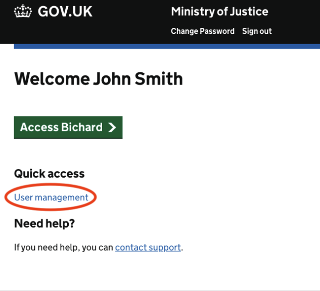
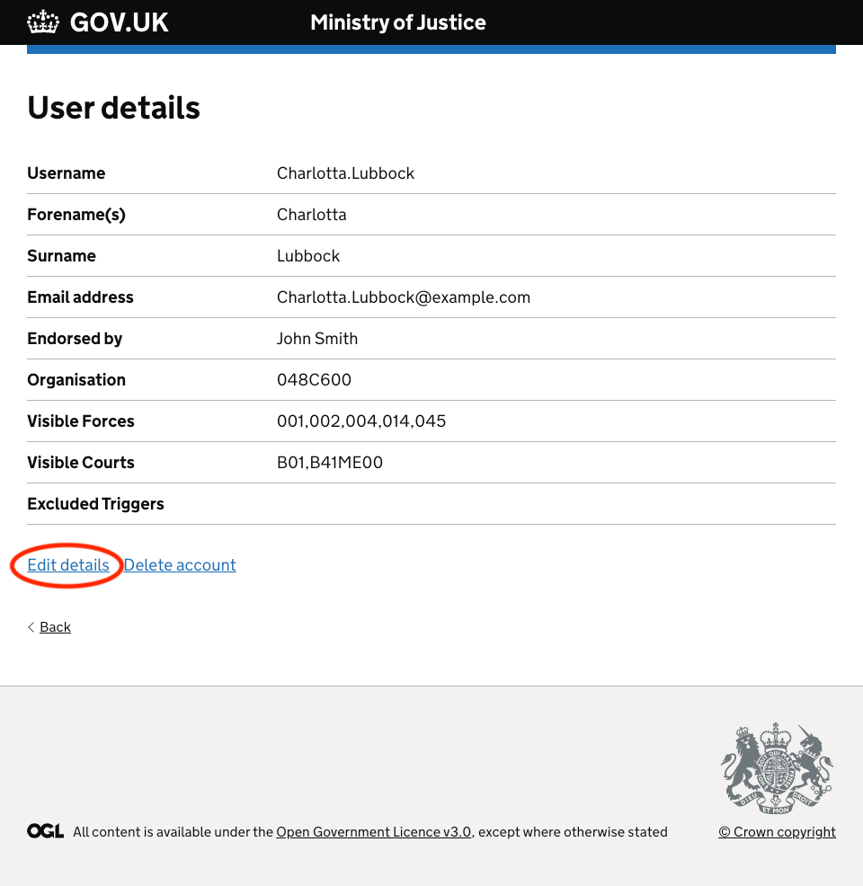

You can manage your team directly in Bichard 7 if you have the User Manager role. This allows you to manage team members in your allocated Force.

If you are a User Manager, you will see the "User Management" option on the login screen.

To edit the details of a user in your Force, click the username of the user you wish to edit from within this list, or search for the user.

You can then click the 'Edit details' link within this page:

